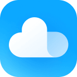

# 米盘 · 小米云盘 Mac 客户端

把小米云盘挂载到 macOS Finder，像打开文件夹一样管理云端文件。

支持上传下载、文件管理、自动连接和命令行。

[下载 Mac 版](https://github.com/champlus/xiaomi-cloud-drive/releases/latest) · [使用说明](docs/USAGE.md) · [命令行](docs/CLI.md)

[](https://github.com/champlus/xiaomi-cloud-drive/releases/latest)
[](https://github.com/champlus/xiaomi-cloud-drive/actions/workflows/ci.yml)


## 功能

- **Finder 挂载**：浏览、预览、上传、下载、重命名和管理文件夹。
- **菜单栏入口**：随时打开云盘和设置。
- **传输管理**：文件进度、实时速度与完成记录，支持上传和下载。
- **自动连接**：登录 Mac 后启动，自动挂载小米云盘。
- **CLI**：支持 `--json`，可供脚本和 Codex 等 agent 调用。

## 安装

当前提供 Apple Silicon（M 系列芯片）版本，需要 macOS 14 或更新版本。

1. 从 [Releases](https://github.com/champlus/xiaomi-cloud-drive/releases/latest) 下载 ZIP 并解压。
2. 将「米盘.app」拖入「应用程序」，打开并登录小米账号。
3. 点击「Finder → 打开」，即可访问云盘。

关闭设置窗口后，米盘会继续在菜单栏运行。启动与挂载选项在「通用」中调整。

## 命令行

CLI 随 App 提供，与图形界面共用登录状态。

```sh
mipan --json ls /资料
mipan put ./notes.txt /资料/notes.txt
mipan get /资料/notes.txt ./notes.txt
```

首次使用可按 [CLI 安装说明](docs/CLI.md#安装) 设置 `mipan` 命令。

## 从源码构建

需要 Go 1.25.2+ 和 Xcode Command Line Tools。Intel Mac 也可在本机编译。

```sh
git clone https://github.com/champlus/xiaomi-cloud-drive.git
cd xiaomi-cloud-drive
scripts/build.sh
scripts/install.sh
```

[开发与测试](docs/DEVELOPMENT.md) · [接口说明](docs/RESEARCH.md)
